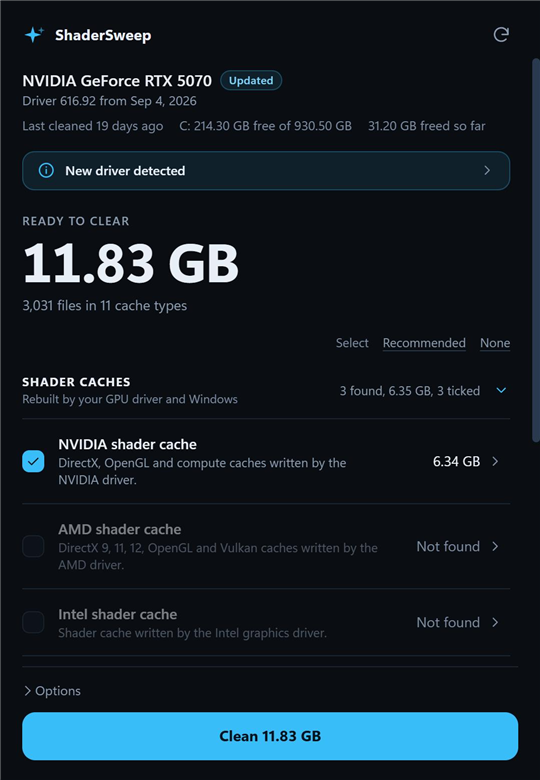
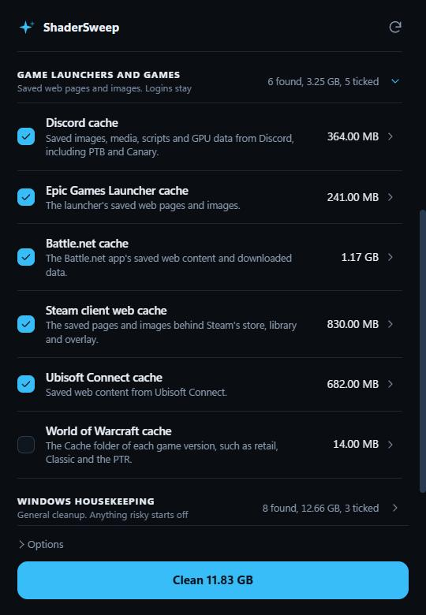
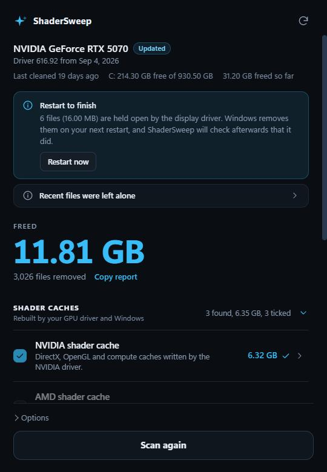

# ShaderSweep

[](https://github.com/Kkthnx/ShaderSweep)
[](https://github.com/Kkthnx/ShaderSweep/releases/latest)
[](https://github.com/Kkthnx/ShaderSweep/releases)
[](LICENSE)

A small Windows app that clears GPU shader caches and the clutter that builds up around them. It scans first, shows you every folder it found with its size, and deletes only what you leave ticked.

<p align="center">
  
  
  
</p>

## When it is worth running

Drivers rebuild their shader caches on their own, so most people never have to touch them. This earns its keep after a driver update that leaves a game stuttering, glitching or crashing, when a cache has swollen to several GB, or when you just want the disk space back. One real run on an RTX 5070 PC freed 9.82 GB.

Expect the first launch of each game afterwards to be a little slower while the driver builds what it needs again.

If you turned on Auto Shader Compilation in the NVIDIA App, leave the NVIDIA row unticked after an update. The driver already rebuilt those shaders for you and a clean would throw that work away.

ShaderSweep keeps each GPU's driver version from your last clean, so it can tell you when a driver has changed since.

## What it cleans

| Group | Rows | Starts ticked |
| --- | --- | --- |
| Shader caches | NVIDIA, AMD, Intel, the Windows DirectX cache, Steam | Yes |
| Game launchers | Discord (including PTB and Canary), Epic Games Launcher, Battle.net, Steam client web cache, EA app, Ubisoft Connect, GOG Galaxy | Yes |
| Game launchers | World of Warcraft `Cache` folders | No |
| Windows housekeeping | Temporary files, thumbnail cache, Delivery Optimization files | Yes |
| Windows housekeeping | Windows Update downloads, Prefetch, error reports, GPU crash dumps, Recycle Bin, Event Viewer logs, driver installer leftovers | No |

Anything that is hard to undo starts off. The Recycle Bin and Event Viewer logs also get a confirmation before a real clean, and the Security log is never cleared.

## How it stays safe

- Only folders on a fixed list of regenerable caches are ever touched. Launcher rows match the tail of the cache path, so logins, settings, `WTF`, `Interface` and the games themselves are out of scope.
- Preview mode measures everything and deletes nothing.
- An app that is open right now starts unticked, because it keeps its files locked.
- Freed space is counted from files that were really deleted. A locked file is never reported as freed.
- The few files the display driver holds can be queued for removal at your next restart. The app checks afterwards that Windows did it.
- It never stops services or closes your programs. Restart now uses the Windows API with force turned off, so an app with unsaved work makes Windows stop and ask.
- No network calls. Nothing is uploaded and there is no update checker.

## Get it

Run this in PowerShell. It checks the download against the SHA-256 hash published with the release and installs nothing if they differ.

```powershell
irm https://raw.githubusercontent.com/Kkthnx/ShaderSweep/main/install.ps1 | iex
```

Or grab the `.exe` or the zip from the [Releases page](https://github.com/Kkthnx/ShaderSweep/releases/latest). Scoop users can use the manifest in [`bucket`](bucket), and the Chocolatey package files are in [`packaging/chocolatey`](packaging/chocolatey).

The exe is not code signed yet, so SmartScreen may warn you the first time. The source is all in this repo and CI builds each release from it.

## Quick start

1. Run ShaderSweep. It asks for administrator rights, since some caches belong to system accounts.
2. Wait for the scan. Each row shows its size, and the arrow next to it lists the exact folders. The header shows free space for every drive that holds a cache, and F5 scans again.
3. Untick anything you want to keep. Select Recommended puts the default ticks back.
4. Press Clean, or turn on Preview only in Options first to see what would go. When it finishes, the result says how much space each drive gained.
5. If files are waiting for a restart, the app offers one with a 60 second countdown you can cancel.

## Command line

For a scheduled task, or to run after a driver install.

```powershell
ShaderSweep.exe --clean --preview          # measure only
ShaderSweep.exe --clean                    # clean the default rows
ShaderSweep.exe --clean --only nvidia,windows
ShaderSweep.exe --clean --include installers
```

Row names for `--only` and `--include` are `nvidia`, `amd`, `intel`, `windows`, `steam`, `discord`, `epic`, `battlenet`, `steamclient`, `ea`, `ubisoft`, `gog`, `wow`, `temp`, `thumbnails`, `deliveryopt`, `wucache`, `prefetch`, `errors`, `gpudumps`, `recyclebin`, `eventlogs` and `installers`.

A row for an app that is running is skipped unless you name it with `--only`. Exit codes are 0 for done, 1 when some files were in use and 2 for an error. The result is saved to `%LOCALAPPDATA%\ShaderSweep\last-run.txt`. `ShaderSweep.exe --help` lists every option.

## The PowerShell script

The original script that started this project is still in [`NvidiaShaderCleanup`](NvidiaShaderCleanup). It stops the NVIDIA services, clears the NVIDIA and Windows shader caches and starts the services again. The app does not stop services, because measuring showed the locked file count was the same either way.

## Building it

Tauri 2 with a vanilla TypeScript front end and a Rust back end. You need Node 22 and a current stable Rust toolchain with the MSVC build tools.

```powershell
cd app
npm ci
npm run tauri build
```

`cargo test` runs the 100 tests in `app/src-tauri`. A few of them write to the pending delete queue in the registry, so they are ignored unless you pass `-- --include-ignored`, which is best done on a throwaway machine.

## Support the work

Free forever. If it saved you time, chip in.

- [Ko-fi](https://ko-fi.com/kkthnx)
- [Buy Me a Coffee](https://buymeacoffee.com/kkthnx)
- [PayPal](https://www.paypal.com/paypalme/kkthnxtv)

Every bit goes back into building more.

## Community

- Glitch Haven Discord: https://discord.gg/FaVGhTYmck
- Website: https://kkthnx.com

## License

MIT. See [LICENSE](LICENSE).
